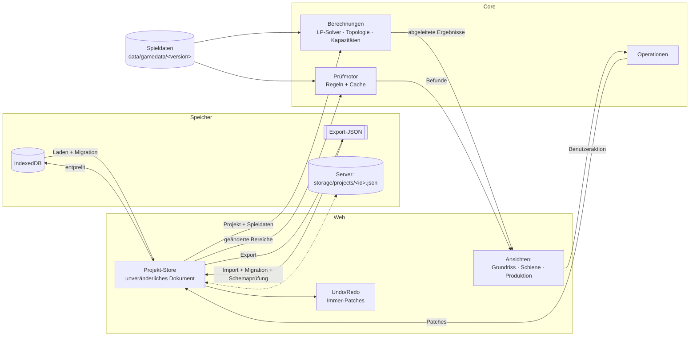

# Architektur

Satis Planner ist eine Webanwendung zur Planung von Satisfactory-Fabriken. Sie verbindet drei Sichten auf **ein** gemeinsames Projektmodell:

1. **Produktion** – Mengenbilanz, Rezeptauswahl, Maschinen, Strom.
2. **Fabrikgrundriss** – maßstabsgetreue Platzierung von Gebäuden, Förderbändern und Rohren auf mehreren Stockwerken.
3. **Schienennetz** – Gleise, Signale, Bahnhöfe, Züge, Fahrpläne und Transportaufträge.

## 1. Module und Zuständigkeiten

| Modul | Ort | Zuständigkeit | Darf abhängen von |
|---|---|---|---|
| **Spieldaten-Werkzeuge** | `packages/gamedata-tools` | Liest die offiziellen Docs-Dateien des Spiels und das Wiki aus und erzeugt den normalisierten Datensatz `data/gamedata/<version>/`. Läuft nur zur Entwicklungszeit. | `core/gamedata/types` |
| **Core: Modell** | `packages/core/src/model` | Projektschema (zod), Typen, IDs, Objektreferenzen. | – |
| **Core: Projekt** | `packages/core/src/project` | Projekt anlegen, Operationen (Befehle), Serialisierung, Import/Export, Formatmigrationen. | Modell, Spieldaten |
| **Core: Spieldaten** | `packages/core/src/gamedata` | Typen des Datensatzes, Index für schnellen Zugriff (Rezepte je Produkt usw.), Datensatz-Registry. | – |
| **Core: Geometrie** | `packages/core/src/geometry` | Vektoren, gedrehte Rechtecke, Schnitttests, Bezierkurven, Kurvenradien. | – |
| **Core: Fabrik** | `packages/core/src/factory` | Gebäudegrundrisse, Anschlusslagen, Kollisionsprüfung, Flächenberechnung, Verlauf von Bändern/Rohren (Verlegemodi), Durchsatzmodell (LP über die eingezeichneten Verbindungen), Höhen- und Liftprüfung, automatisches Layout aus einem Produktionsplan (`autoLayout.ts`: Linien, Hauptbus, Höhenstaffel gegen Kreuzungen, Varianten, Prüfung an einer Projektkopie inkl. Kreuzungszählung). | Geometrie, Spieldaten, Produktion (Maschinenraten) |
| **Core: Produktion** | `packages/core/src/production` | Lineares Programm für die Produktionsplanung (Ziele, Rohstoffgrenzen, Maschinengrenzen), Bilanz Soll/Geplant/Platziert/Angeschlossen/Durchsatz, Produktionsgraph mit Schichtenlayout und Sortierung nach Kettenstufe, Rezeptvergleich (Kosten je Rezept für 60/min). | Spieldaten |
| **Core: Schiene** | `packages/core/src/rail` | Gleistopologie, Blockbildung, Signalprüfregeln, Wegfindung (BFS und Dijkstra), vereinfachte Zugsimulation (Blöcke, Pfadreservierung, Halte, Deadlock- und Kollisionserkennung). | Geometrie, Spieldaten |
| **Core: Transport** | `packages/core/src/transport` | Zugkapazität, Umlaufschätzung, Durchsatz je Auftrag, Bilanz lokal/extern je Fabrik, Transportbefunde. | Schiene, Produktion |
| **Core: Mehrsprachigkeit** | `packages/core/src/i18n` | `tr()` mit deutschem Quelltext als Schlüssel, Wörterbücher je Sprache, Zahlenformat. Prüfmeldungen und Fehlermeldungen des Kerns werden übersetzt. | – |
| **Core: Prüfung** | `packages/core/src/validation` | Einheitliches Befundformat, Regelkatalog, Prüfmotor mit Zwischenspeicher je Teilbereich. | alle Core-Module |
| **Web-App** | `apps/web` | React-Oberfläche: Layout, Zustand, Undo/Redo, Autosave, Canvas-Editoren, Panels, Einstellungen (Sprache, Farbschema, Tastenbelegung), geführte Touren, Projekt-Link. | Core |
| **Server** | `apps/server` | Projekte als JSON-Dateien unter geheimen Links (`/f/<id>`, kein Login), optimistische Sperre über Revisionen, Rate-Limit. Liefert auch die statische Web-App aus. Optional: Ohne Server bleibt die App voll nutzbar (IndexedDB). | Core (Schema und Migrationen) |

**Grundsatz:** Alles, was rechnet oder prüft, liegt in `@satis/core`, ist frei von React und DOM und läuft ohne Editor in Vitest. Die Web-App ruft nur Funktionen auf und stellt Ergebnisse dar.

## 2. Technologie-Stack (mit Begründung)

| Bereich | Wahl | Begründung |
|---|---|---|
| Sprache | **TypeScript** (strikt) | Ein Typmodell für Core, UI und Server. Das Projektschema wird nur einmal definiert. |
| Monorepo | **npm-Workspaces** | Kommt mit Node mit, kein zusätzliches Werkzeug. Pakete werden als Quellcode eingebunden, ohne eigenen Build-Schritt. |
| UI | **React 19 + Vite** | Verbreitet, schneller Entwicklungsserver. Vite baut eine statische App, die auf jedem Webserver läuft. |
| Zustand | **Zustand + Immer (Patches)** | Das Projekt ist ein unveränderliches Dokument. Immer erzeugt zu jeder Änderung Patches und Gegen-Patches. Daraus entstehen Undo/Redo, gezielte Neuprüfung und später Synchronisation. |
| Schema | **zod** | Laufzeitprüfung bei Import, Laden und auf dem Server. TypeScript-Typen werden daraus abgeleitet. |
| Lokale Speicherung | **IndexedDB** (`idb`) | Projekte können mehrere MB groß sein, localStorage reicht dafür nicht. Funktioniert ohne Konto und offline. |
| Optimierung | **YALPS** (lineare Programmierung, reines TS) | Produktionskreisläufe, Nebenprodukte und Rohstoffgrenzen sind ein lineares Problem. Ein rekursiver Rezeptbaum kann Kreisläufe nicht korrekt lösen. YALPS läuft synchron in Browser und Tests. Hinter der Schnittstelle `LpSolver` könnte später HiGHS (WASM) treten. |
| Tests | **Vitest** | Gleiche Konfiguration wie Vite, schnell, TypeScript ohne Zusatzaufwand. |
| Server | **Fastify + Dateiablage** | Ein einziger Node-Prozess liefert API und statische App aus. Eine JSON-Datei pro Projekt, atomar geschrieben – keine Datenbank nötig, Sicherung per tar. Betrieb im Docker-Container hinter Tailscale Funnel (siehe README). |
| Mehrsprachigkeit | **eigenes `tr()`** (deutscher Quelltext = Schlüssel) | Kein zusätzliches Paket; fehlende Übersetzungen fallen auf Deutsch zurück; ein Test prüft, dass jeder Text übersetzt ist und Platzhalter erhalten bleiben. |

### Rendering: Canvas 2D statt WebGL, 3D später zusätzlich

Was der Editor leisten muss:

- Exakte, maßstäbliche Linien und Flächen, gestrichelte Abstandslinien, Bemaßungstext, Raster.
- Größenordnung: eine große Fabrik hat einige tausend Gebäude und Bandabschnitte, ein Schienennetz einige tausend Segmente.
- Präzise Trefferprüfung (Anschlüsse, Signale an Gleisverbindungen).
- Mehrere Stockwerke, die ein- und ausgeblendet oder transparent dargestellt werden.

**Entscheidung: Canvas 2D mit eigenem, schlankem Szenen-Renderer.**

- Canvas 2D kann Text, Strichmuster, Bezierkurven und Antialiasing von Haus aus. In WebGL (auch mit PixiJS) wären gestrichelte Linien, scharfer Text und Kurven mit konstanter Linienbreite deutlich aufwendiger.
- Mit Sichtbereichs-Culling über einen räumlichen Index zeichnet Canvas 2D 10.000+ einfache Formen flüssig. Das reicht für die Zielgröße.
- Die Trefferprüfung erfolgt geometrisch im Core, in Weltkoordinaten. Sie hängt nicht vom Rendering ab.
- Der Renderer liegt hinter einer kleinen Schnittstelle (Zeichenschichten: Raster, Inhalt, Overlay). Zeigt das Profiling Engpässe, kann eine Schicht auf WebGL umgestellt werden, ohne Werkzeuge oder Modell zu ändern.
- **3D-Ansicht (später):** three.js (WebGL) als zusätzliche Ansicht. Das Datenmodell speichert dafür schon heute Höhen (z), Stockwerke, Kollisionsboxen in 3D und Gleishöhen. Die 3D-Ansicht liest dasselbe Projekt.

## 3. Ordnerstruktur

```
satis-planner/
├─ package.json              Workspaces und Skripte
├─ tsconfig.base.json        Gemeinsame TS-Optionen
├─ vitest.config.ts
├─ docs/                     Diese Dokumentation
│  ├─ ARCHITEKTUR.md
│  ├─ DATENMODELL.md
│  ├─ SPIELREGELN.md         Verifizierte Spielmechaniken und Prüfregeln mit Quellen
│  ├─ SPIELDATEN.md          Quellen, Versionen, Lizenzen, Aktualisierung
│  ├─ ENTWICKLUNGSPLAN.md    Etappen und Abnahmekriterien
│  └─ BETRIEB.md             Entwicklung, Build, Migrationen, Deployment
├─ data/
│  └─ gamedata/
│     └─ 1.2.4.0/
│        ├─ gamedata.json    Normalisierter Datensatz (generiert)
│        └─ EXTRAKTION.md    Bericht mit Abweichungen und Hinweisen
├─ packages/
│  ├─ core/
│  │  ├─ src/
│  │  │  ├─ model/           Projektschema, IDs, Referenzen
│  │  │  ├─ project/         Erzeugen, Operationen, Serialisierung, Migrationen
│  │  │  ├─ gamedata/        Datensatz-Typen und Index
│  │  │  ├─ geometry/
│  │  │  ├─ factory/
│  │  │  ├─ production/
│  │  │  ├─ rail/
│  │  │  ├─ transport/
│  │  │  ├─ map/             Weltkarte: Standorte, Weltraster, Vorkommen, Prüfregeln MAP-*, Standortvorschlag
│  │  │  └─ validation/
│  │  └─ test/               Vitest-Tests (ohne UI)
│  └─ gamedata-tools/
│     ├─ src/                extract.ts, fetch-wiki-infobox.ts, fetch-map.ts, ue-parse.ts
│     └─ curated/            Kuratierte Ergänzungen mit Quellenangabe
└─ apps/
   ├─ web/
   │  ├─ public/gamedata/    Kopie des Datensatzes zur Auslieferung (Build-Schritt)
   │  └─ src/
   │     ├─ app/             Layout, Navigation, Tastenkürzel
   │     ├─ state/           Projekt-Store, Undo/Redo, Autosave, Auswahl
   │     ├─ persistence/     IndexedDB, Import/Export
   │     ├─ canvas/          Viewport, Renderer, Treffer, Werkzeug-Infrastruktur
   │     ├─ i18n/            Wörterbuch der Oberfläche (Englisch), Übersetzungstest
   │     ├─ features/
   │     │  ├─ factory/      Grundriss, Seitenansicht, Werkzeugleiste, Eigenschaften, Bilanz, Blackbox-Ansicht
   │     │  ├─ autolayout/   Dialog „Layout automatisch erzeugen“ (Vorgaben, Varianten, Vorschau, Prüfung)
   │     │  ├─ rail/         Schienen-Editor
   │     │  ├─ production/   Produktionsplanung und Bilanz, Rezepte nachschlagen
   │     │  ├─ transport/    Transportaufträge, Schätzung, Bilanz lokal/extern
   │     │  ├─ map/          Weltkarte: Kartenbild (Kacheln live), Vorkommen, Standorte, Standortvorschlag
   │     │  ├─ settings/     Sprache, Farbschema, Tastenbelegung, Spieldatensatz
   │     │  ├─ tutorial/     Geführte Touren
   │     │  ├─ link/         Projekt-Link (Leiste mit Kopieren)
   │     │  └─ findings/     Befundliste (je Ansicht gefiltert)
   │     └─ ui/              Wiederverwendbare Bausteine
   └─ server/
      ├─ src/                app.ts (API), storage.ts (Dateiablage), rateLimit.ts, config.ts, main.ts
      └─ test/               API-Tests (Temp-Ordner), fixtures/ mit alten Formaten
```

## 4. Datenfluss



1. **Eingabe:** Jede Benutzeraktion ruft eine *Operation* aus `core/project/ops` auf, etwa `placeBuilding` oder `addSignal`. Operationen sind reine Funktionen auf einem Immer-Entwurf.
2. **Änderung:** Der Store wendet die Operation mit `produceWithPatches` an. Patches und Gegen-Patches landen im Undo-Verlauf. Die Pfade der Patches zeigen, welche Bereiche sich geändert haben, z. B. `railSegments/…` oder `buildings/…`.
3. **Ableitung:** Berechnungen sind reine Funktionen `(Projekt, Spieldaten) → Ergebnis`. Sie sind auf Ebene von Netz, Fabrik oder Plan zwischengespeichert. Ändert sich nur Schienennetz A, werden auch nur dessen Blöcke und Prüfregeln neu berechnet.
4. **Prüfung:** Der Prüfmotor sammelt die Befunde aller Regeln. Jeder Befund hat einen stabilen Schlüssel. Bestätigte oder ignorierte Befunde merkt sich das Projekt (`findingStates`), alles andere wird abgeleitet und nicht gespeichert.
5. **Darstellung:** Editoren zeichnen Modell und Befunde, Panels zeigen Bilanzen und Befundlisten. Ein Klick auf einen Befund wählt das Objekt aus und zentriert die Ansicht darauf.
6. **Speicherung:** Der Autosave schreibt das Dokument nach einer Pause von 800 ms in IndexedDB. Export erzeugt versioniertes JSON. Import prüft das Format, migriert es bei Bedarf und prüft dann das Schema.

### Produktionsplan und Grundriss: ein Datenbestand

Es gibt **keine** zweite Maschinenliste für die Produktionsansicht.

- **Soll:** `ProductionPlan` speichert nur Ziele, Rezeptauswahl und Grenzen. Der LP-Solver berechnet daraus den Sollbedarf an Maschinen je Rezept. Das ist ein abgeleitetes Ergebnis.
- **Geplant:** Maschinen sind `Building`-Objekte mit Rezept und Takt. Eine Maschine ohne `placement` ist geplant, aber noch nicht aufgestellt. Die Produktionsansicht kann aus dem Sollbedarf solche Maschinen anlegen.
- **Platziert:** Dasselbe `Building` mit `placement` erscheint im Grundriss. Beim Platzieren entsteht kein neues Objekt, es bekommt nur eine Position.
- **Verbunden:** `LogisticsLink`-Objekte verbinden konkrete Anschlüsse. Ihre Kapazität ergibt sich aus der Band- oder Rohrstufe.

- **Durchsatz:** Das Durchsatzmodell der Fabrik (lineares Programm über die eingezeichneten Verbindungen) berechnet, wie weit jede Maschine mit den gezeichneten Band- und Rohrstufen tatsächlich läuft. Es rechnet einmal ohne und einmal mit Kapazitätsgrenzen; so wird der theoretische Bedarf von der Kapazität der eingezeichneten Verbindungen unterschieden.

Die Bilanzansicht zeigt je Rezept und Gegenstand die fünf Stufen **Soll → Geplant → Platziert → Angeschlossen → Durchsatz** nebeneinander. So ist jederzeit sichtbar, was nur gerechnet, was angelegt, was aufgestellt, was angeschlossen ist und was tatsächlich läuft.

### Benutzereinstellungen und Oberfläche

Sprache, Farbschema, Tastenbelegung, Flussanimation und Tutorialstand sind **keine** Projektdaten. Sie liegen im localStorage des Browsers (`prefsStore`). Ein Sprachwechsel baut die Oberfläche neu auf; Prüfergebnisse werden in der neuen Sprache neu erzeugt (der Prüfmotor speichert die Sprache im Zwischenspeicher mit). Die Zugsimulation läuft nur in der Oberfläche (`simStore`) und wird zurückgesetzt, sobald sich das Netz ändert.

### Server

Der Server ist optional. Er speichert jedes Projekt als eigene JSON-Datei `storage/projects/<id>.json` (Inhalt = Projekt im aktuellen Format, `formatVersion` auf oberster Ebene) und führt beim Speichern und Laden dieselbe Migrations- und Schemaprüfung aus wie der Browser (`importProject` aus `@satis/core`). Die ID ist zugleich der geheime Link `/f/<id>`. Gleichzeitiges Speichern von zwei Geräten erkennt er über die Revision (Hash des Dateiinhalts) und antwortet mit 409; die Oberfläche fragt dann, welcher Stand gelten soll.

## 5. Erweiterbarkeit und Versionierung

- **Projektformat:** `formatVersion` (ganze Zahl). `core/project/migrations.ts` enthält eine Kette `v1→v2→…`. Sie wird beim Laden aus IndexedDB, beim Import und auf dem Server angewendet.
- **Spieldaten:** Jedes Projekt speichert `gameData.datasetId` (z. B. `sf-1.2.4.0`). Mehrere Datensätze können nebeneinander existieren. Der Wechsel (`project/gamedataMigration.ts`, Einstellungen → Spieldaten) erstellt erst einen Bericht (fehlende Gebäude, Rezepte, Gegenstände; optionale Umbenennungstabelle) und wendet ihn dann rückgängig machbar an. Gebäude mit unbekanntem Typ bleiben erhalten und erscheinen als Befund FAB-010.
- **3D:** Die Positionen sind dreidimensional (x, y, z), die Kollisionsboxen kommen aus den Spieldaten. Gleisknoten haben eine Höhe.
