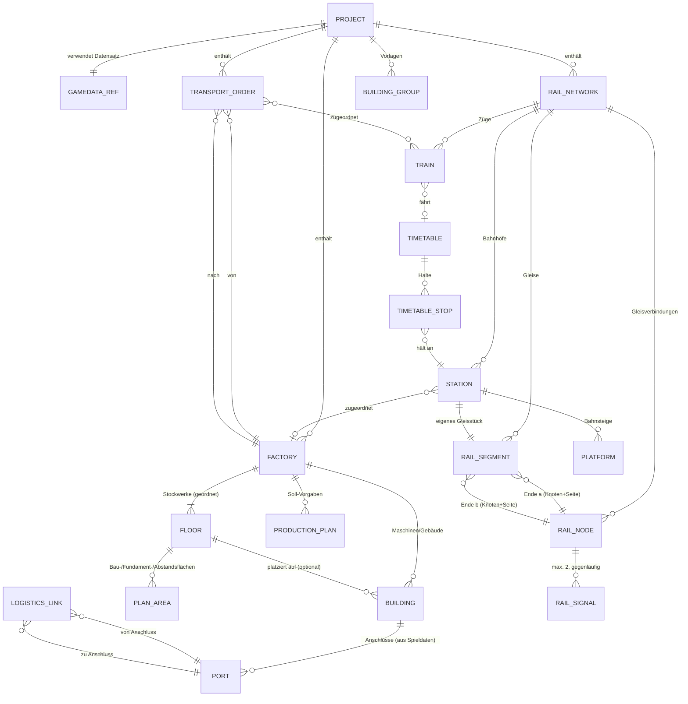

# Datenmodell

Ein Projekt ist **ein JSON-Dokument**, das Projektformat Version 2 (Migration von Version 1 automatisch). Alle Objekte liegen normalisiert in ID-Tabellen auf Projektebene, also `project.buildings[id]`, `project.railSegments[id]` usw., und verweisen nur über IDs aufeinander. Dadurch:

- sind Verweise stabil und lassen sich prüfen (`repairReferences`),
- erzeugen Änderungen kleine Immer-Patches (Undo/Redo, gezielte Neuprüfung, später Synchronisation),
- greifen Produktionsansicht, Grundriss und Schienennetz auf dieselben Objekte zu.

Die maßgebliche Definition ist das zod-Schema in [`packages/core/src/model/schema.ts`](../packages/core/src/model/schema.ts).

## Konventionen

| Thema | Festlegung |
|---|---|
| IDs | `<präfix>_<12 Zeichen>`, z. B. `bld_k3j…`, `seg_…`. Werden nie wiederverwendet. |
| Koordinaten | Weltkoordinaten in **Metern**: x nach rechts, y nach unten (Draufsicht), z nach oben. |
| Drehung | Grad, im Uhrzeigersinn in der Draufsicht. Für Gebäude entspricht das der Docs-Ausrichtung (lokal x/y wie `mClearanceData`). |
| Mengen | Feststoffe in Stück, Flüssigkeiten und Gase in **m³**, Raten pro **Minute**. |
| Takt | Faktor (1 = 100 %). |
| Spieldaten-Verweise | Klassennamen aus den Docs, z. B. `Build_ConstructorMk1_C`, `Recipe_IronPlate_C`, `Desc_IronPlate_C`. |

## Übersicht

## Objekte

### Projekt
`formatVersion`, `id`, `name`, `description`, `createdAt`, `updatedAt`, `gameData { datasetId, gameVersion }`, `settings` (Raster, Fangweite, Fangwinkel, Simulationseinstellungen), dazu alle ID-Tabellen und `findingStates` (bestätigte oder ignorierte Befunde, Schlüssel = Befundschlüssel).

### Fabrik, Stockwerk, Fläche
- **Factory**: `name`, `color`, `floorIds` (geordnet nach Höhe), `notes`, `map` (Standort auf der Weltkarte oder `null`): `{ x, y, rotationDeg }` – der lokale Ursprung des Grundrisses liegt am Weltpunkt (x, y) in Metern, der Grundriss ist um `rotationDeg` im Uhrzeigersinn gedreht. Welt = Drehung(lokal) + (x, y). Weltkoordinaten sind die Spielkoordinaten in Metern (x Osten, y Süden). Schienennetze liegen direkt in Weltkoordinaten. `blackbox` (seit Format 4, Standard `false`): Die Fabrik wird nur über ihre Produktionspläne geplant; Grundrissprüfungen entfallen, Herstellung und Verbrauch für den Transport stammen aus den Plänen, die Kartenfläche wird aus den Maschinen geschätzt.
- **Floor**: *physisches* Stockwerk mit `elevationM` (Oberkante Boden), `heightM` (lichte Höhe) und `kind` (`production`, `logistics` oder `other`). Eine Logistikebene unter der Produktion ist einfach ein eigenes Stockwerk mit `kind = logistics`. Neue Ebenen: Produktion 18 m, Logistik 6 m lichte Höhe, über der obersten Ebene mit 2 m Decke (Beispiel: Erdgeschoss 0–18 m, Logistik 20–26 m, Ebene 28–46 m). Die Werte sind nur Vorgaben und bleiben frei änderbar.
- **PlanArea**: Polygon auf einem Stockwerk, `kind`:
  - `build-area` – selbst festgelegte Baufläche,
  - `foundation` – Fundamentfläche mit `foundationType` (Kachelmaß aus den Spieldaten),
  - `clearance` – frei definierbarer Planungsabstand (Lauf- oder Wartungsweg).

*Darstellungsebenen* (Gebäude, Bänder, Rohre, Anschlüsse, Maße …) sind dagegen reine Anzeigeoptionen der Oberfläche und **nicht** Teil des Projekts.

### Gebäude und Maschinen
**Building**: `type` (Gebäudeklasse), `recipeId`, `clock`, `somersloops`, `label`, `notes`, `groupInstance { groupId, instanceId, memberKey }`, `extraction { itemId, purity, nodeId }` (nur Gewinnungsgebäude: geförderter Rohstoff und Reinheit unrein/normal/rein; `nodeId` = verknüpftes Vorkommen der Weltkarte oder `null`, ein Vorkommen trägt nur ein Gebäude), `transfer { mode: load|unload, stationId }` (nur Frachtplattformen sowie Lkw- und Tanklaster-Stationen: Schnittstelle zu Transportaufträgen; `stationId` nur bei Frachtplattformen), `stationPart { stationId, platformId }` oder `null` (Bahnhofsgebäude bzw. Bahnsteig, der mit einem Bahnhof im Schienennetz abgeglichen wird; `platformId = null` = Bahnhofsgebäude; Standardwert `null`, daher ohne Formatänderung) und

- `placement: null` → **geplant, nicht aufgestellt** (erscheint in „Nicht platziert“ und in der Bilanz als „geplant“),
- `placement: { floorId, x, y, zOffsetM, rotationDeg, vertical? }` → im Grundriss aufgestellt. `vertical` (`up` | `down`) gibt es nur bei Pipeline-Pumpen: senkrecht eingebaut mit Förderrichtung nach oben bzw. unten. Fehlt das Feld, liegt das Gebäude waagrecht. Ältere Dateien ohne das Feld bleiben gültig, eine Formatänderung war dafür nicht nötig.

Abmessungen und Kollisionsboxen werden **nicht** im Projekt gespeichert, sondern aus den Spieldaten gelesen (`mClearanceData`). So bleibt das Projekt schlank und nutzt nach einem Datensatzwechsel automatisch die neuen Maße.

### Anschlüsse und Verbindungen
- **Anschluss** (abgeleitet, nicht gespeichert): stabile ID `belt-in-0`, `belt-out-0`, `pipe-in-0`, `pipe-any-2` … Die Anzahl stammt aus den Spieldaten (Wiki-Infobox bzw. aus Rezepten abgeleitet), die Lage ist schematisch (`positionVerified: false`).
- **LogisticsLink**: `kind` (`belt` oder `pipe`), `tier` (Band- bzw. Rohrstufe als Gebäudeklasse), `from`/`to` als **PortRef `{ buildingId, portId }`** (immer in Flussrichtung Ausgang → Eingang, auch wenn vom Eingang aus gezeichnet), `waypoints` (3D), `routing` (`direct` = gerade Abschnitte, `straight` = rechtwinklig, `curved` = weiche Kurve). Ein senkrechter Abschnitt (gleiche x/y-Lage, andere Höhe) steht für einen Förderlift bzw. ein senkrechtes Rohr.
- Splitter, Zusammenführungen und Rohrkreuzungen sind Gebäude mit Anschlüssen. Es gibt keinen eigenen Objekttyp dafür.

### Gebäudegruppen
**BuildingGroup**: Vorlage mit relativen Mitgliedern (`key`, Typ, Rezept, Takt, Lage) und internen Verbindungen. Beim Einfügen entstehen normale `Building`- und `LogisticsLink`-Objekte mit `groupInstance { groupId, instanceId, memberKey }`. Es ist eine Kopie, keine Live-Verknüpfung. Über `memberKey` lassen sich Ursprung und Drehung einer Instanz rekonstruieren: eine geänderte Instanz kann als neue Vorlage übernommen und auf alle anderen Instanzen übertragen werden (gleiche Lage).

### Produktion
**ProductionPlan** (je Fabrik, auch mehrere): `mode` (`target` oder `maximize`), `targets [{ itemId, ratePerMin }]`, `supplies [{ itemId, maxPerMin, origin: local|import }]`, `enabledAlternates`, `disabledRecipes`, `machineLimits`, `limitToExistingMachines`, `optimize`.

Das Ergebnis des Solvers (Rezeptraten, Maschinenzahlen, Nebenprodukte, Strom, Engpässe) ist **abgeleitet** und wird nicht gespeichert.

### Schiene
- **RailNetwork**: `name`, `color`. Mehrere Netze pro Projekt, unabhängig oder verbunden. Zum Verbinden zweier Netze werden sie zusammengeführt (Etappe 3).
- **RailNode** (Gleisverbindung): `position` (3D), `headingDeg`. Ein Knoten hat **zwei Seiten**: A liegt entgegen der Achse, B in Achsrichtung. Ein Zug fährt durch einen Knoten immer von einem A-Segment zu einem B-Segment oder umgekehrt. Mehrere Segmente auf einer Seite bilden eine **Weiche**.
- **RailSegment**: `a`/`b` = `{ nodeId, side }`. Die Geometrie ist eine kubische Bezierkurve; die Tangenten folgen aus den Knotenachsen, `handleA` und `handleB` bestimmen die Kurvenform. `stationId` markiert Bahnhofsgleise. `intendedDirection` ist eine Planungsangabe.
- **Geometrische Kreuzung vs. Gleisverbindung:** Eine Verbindung besteht **nur** über einen gemeinsamen Knoten. Schneiden sich zwei Segmente ohne gemeinsamen Knoten, ist das eine geometrische Kreuzung. Sie wird berechnet und nicht gespeichert, die Höhe (z) wird dabei berücksichtigt.
- **RailSignal**: `nodeId`, `kind` (`block` oder `path`), `facing` (`forward` = gilt für Fahrt A→B). Höchstens zwei Signale je Knoten, gegenläufig.
- **Station**: `name`, `factoryId`, `platforms [{ type: freight|fluid|empty, mode: load|unload }]`, eigenes Gleisstück `segmentId` von `backNodeId` nach `frontNodeId`. Züge halten nur bei Einfahrt von hinten nach vorn.
- **Train**: `consist` (von vorn nach hinten: Lokomotiven mit `reversed`, Wagen mit `cargo`), `timetableId`.
- **Timetable**: `stops [{ stationId, waitS, condition, transfer, itemIds }]`.

### Transport
**TransportOrder**: `itemId`, `ratePerMin`, `fromFactoryId`, `toFactoryId`, `mode` (`train` | `vehicle` | `belt` | `pipe`, Standard `train`), optional die Bahnhöfe, `trainIds`, `roundTripEstimateS` (manuelle Umlaufzeit für Zug bzw. Fahrzeug; leer = Schätzung bzw. Messung aus der Simulation), `vehicle { type, count, distanceM, speedKmh }` (nur Fahrzeugaufträge; `type` = Fahrzeugklasse aus den Spieldaten, `speedKmh` leer = Höchstgeschwindigkeit) und `direct { tier, lines, lengthM, from, to }` (nur direkte Bänder/Rohre; `from` = Ausgang in der liefernden, `to` = Eingang in der empfangenden Fabrik, jeweils `{ buildingId, portId }`). Die neuen Felder haben Standardwerte; ältere Dateien werden ohne Formatwechsel als Zugaufträge gelesen.

Die Annahmen der Schätzung stehen in `settings.simulation`: `trainAverageSpeedKmh` (Annahme 80 km/h), `dockingS` (Umschlag je Halt, Wiki 27,08 s), `timeStepS`, `durationS`.

### Kartendaten (nicht im Projekt)
Die Lage der Rohstoffvorkommen gehört zum Spieldatensatz (`data/gamedata/<version>/map.json`, Typ `MapData` in [`map/types.ts`](../packages/core/src/map/types.ts)): je Vorkommen `id` (Objektname der Spielwelt, z. B. `BP_ResourceNode555`), `kind` (`node`, `well`, `well-core`, `geyser`), `itemId`, `purity`, `x`/`y`/`z` in Metern, bei Satelliten `coreId`. Das Projekt speichert nur die Verknüpfung `extraction.nodeId`. Ansicht, Filter und Standortvorschläge der Karte sind Oberflächenzustand.

### Befunde (abgeleitet)
`Finding { key, ruleId, severity (error|warning|info), kind (game-rule|recommendation|unchecked), certainty (static|dynamic), domain, objects[], message, explanation, suggestion, location }`. Gespeichert wird nur `findingStates[key]`.

## Serverablage (optional)

Eine Datei pro Projekt: `storage/projects/<id>.json`. Inhalt ist das Projekt selbst (wie `project` in der Exportdatei, mit `formatVersion` auf oberster Ebene). `<id>` sind 16 Zufallsbytes als base64url (22 Zeichen) und zugleich der geheime Link `/f/<id>`; die `id` im Projekt selbst ist davon unabhängig. Die Revision für die optimistische Sperre ist ein Hash des Dateiinhalts und wird nicht gespeichert. Ältere Formate bleiben bis zum nächsten Speichern unverändert auf der Platte und werden beim Laden migriert.

## Versionierung

- `formatVersion` und Migrationskette: [`project/migrations.ts`](../packages/core/src/project/migrations.ts). Schritt 1 → 2: Verlegemodus, Gewinnung, Frachtplattformen, `memberKey`; `stopDurationS` durch `dockingS` ersetzt. Schritt 2 → 3: `factories.*.map = null`, `extraction.nodeId = null` (Gebäude und Gruppenmitglieder). Schritt 3 → 4: `factories.*.blackbox = false`.
- Exportdatei: `{ kind: "satis-planner-project", formatVersion, exportedAt, app, project }`.
- Beim Import und beim Laden: Migration → Schemaprüfung (zod) → Bereinigung ungültiger Verweise mit Bericht.
